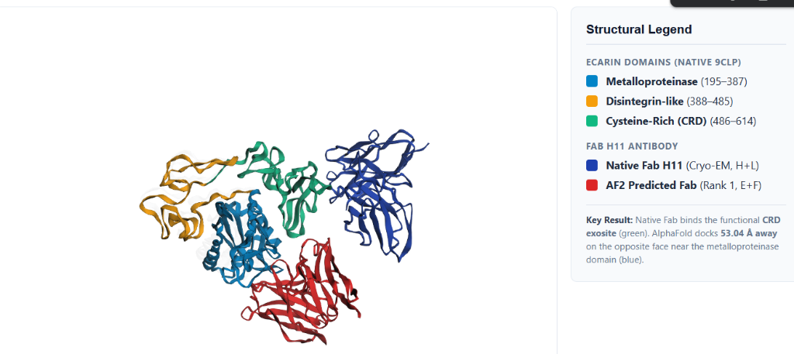

# AlphaFold 2 Multimer Benchmark on PDB 9CLP: De Novo Antibody–Antigen Docking Failure Despite Near-Atomic Domain Folding

[](https://www.python.org/)
[](https://opensource.org/licenses/MIT)
[](https://www.rcsb.org/structure/9CLP)
[](https://colab.research.google.com/github/Phil3322/af2-9clp-benchmark/blob/main/AlphaFold2.ipynb)

This repository provides a reproducible, self-contained computational benchmark evaluating **AlphaFold 2 Multimer v3** (ColabFold, templates disabled) on a challenging post-training cryo-EM complex: the prothrombin-activating snake venom metalloproteinase **Ecarin** in complex with the synthetic neutralizing antibody **Fab H11** ([PDB 9CLP](https://www.rcsb.org/structure/9CLP); [EMD-45728](https://www.ebi.ac.uk/emdb/EMD-45728); *Misson Mindrebo et al., Toxins 2024*).

<p align="center">
  
  <br>
  <em><b>Figure 1: Domain-Annotated Structural Superimposition of Native Cryo-EM Ground Truth vs. AlphaFold 2 Multimer (Rank 1).</b><br>
  <b>Cyan:</b> Metalloproteinase domain (195–387).<br>
  <b>Amber / Gold:</b> Disintegrin-like domain (388–485).<br>
  <b>Emerald Green:</b> Cysteine-Rich Domain (CRD) exosite (486–614).<br>
  <b>Royal Blue:</b> Native Fab H11 (Cryo-EM ground truth, bound to the functional CRD exosite).<br>
  <b>Crimson Red:</b> AlphaFold 2 Multimer Rank 1 predicted Fab H11 (docked 53.04 Å away near the metalloproteinase domain).</em>
</p>

---

## Key Scientific Findings

1. **Near-Atomic Intra-Molecular Domain Folding**:
   AlphaFold 2 Multimer folds all constituent domains of the 420-residue toxin and the 230-residue antibody Fv with sub-Ångström to near-atomic backbone accuracy:
   * **Metalloproteinase domain (193 aa)**: $1.06\text{ \AA}$ $\text{C}_\alpha$ RMSD (mean pLDDT 88.0)
   * **Disintegrin-like domain (98 aa)**: $0.97\text{ \AA}$ $\text{C}_\alpha$ RMSD (mean pLDDT 88.0)
   * **Cysteine-rich domain exosite (129 aa)**: $1.15\text{ \AA}$ $\text{C}_\alpha$ RMSD (mean pLDDT 88.0)
   * **Full mature enzyme (420 aa)**: $1.62\text{ \AA}$ $\text{C}_\alpha$ RMSD (mean pLDDT 88.0)
   * **Antibody $\text{V}_{\text{H}}$ domain (120 aa)**: $1.27\text{ \AA}$ $\text{C}_\alpha$ RMSD (mean pLDDT 81.1)
   * **Antibody $\text{V}_{\text{L}}$ domain (110 aa)**: $0.77\text{ \AA}$ $\text{C}_\alpha$ RMSD (mean pLDDT 82.1)
   * **Antibody Fv dimer ($\text{V}_{\text{H}} + \text{V}_{\text{L}}$)**: $1.26\text{ \AA}$ $\text{C}_\alpha$ RMSD (mean pLDDT 81.6)

2. **100% Blind Docking Failure Across 20 Models (CAPRI Incorrect)**:
   Despite near-atomic tertiary folds, blind docking of the antibody to the CRD exosite fails completely across all 20 independently sampled trajectories (20 recycles, 4 random seeds on an NVIDIA A100-SXM4-80GB GPU):
   * **DockQ score**: $0.010\text{--}0.026$ (mean $\approx 0.015$)
   * **Ligand RMSD ($\text{lRMSD}$)**: $39.5\text{--}57.1\text{ \AA}$ (mean $\approx 46.2\text{ \AA}$)
   * **Interface RMSD ($\text{iRMSD}$)**: $13.3\text{--}18.6\text{ \AA}$ (mean $\approx 15.6\text{ \AA}$)
   * **Native contact recovery ($F_{\text{nat}}$)**: $0/42$ native contacts recovered in 19 models ($F_{\text{nat}} = 0.000$); $1/42$ in 1 model ($F_{\text{nat}} = 0.024$).

3. **Sampling Depth Does Not Rescue Interface Prediction**:
   Increasing recycles to 20 (standard Multimer v3 default) and expanding sampling across 4 random seeds does not rescue interface prediction, demonstrating that the failure is not an artifact of shallow sampling. Rather, it exposes a fundamental blind spot of MSA-driven deep learning models when predicting *in vitro*-selected synthetic antibodies that lack natural phylogenetic co-evolutionary covariance with their target.

---

## Benchmark Results (20 Models)

| Rank | Model / Seed | DockQ | CAPRI Quality | $F_{\text{nat}}$ | iRMSD (Å) | lRMSD (Å) | ipTM | pTM |
| :---: | :---: | :---: | :---: | :---: | :---: | :---: | :---: | :---: |
| **rank_001** | m5_s003 | 0.011 | **Incorrect** | 0.000 | 17.98 | 53.04 | 0.370 | 0.640 |
| **rank_002** | m4_s001 | 0.010 | **Incorrect** | 0.000 | 17.63 | 57.12 | 0.340 | 0.620 |
| **rank_003** | m2_s000 | 0.010 | **Incorrect** | 0.000 | 18.58 | 53.55 | 0.330 | 0.650 |
| **rank_004** | m3_s002 | 0.011 | **Incorrect** | 0.000 | 18.35 | 52.48 | 0.370 | 0.640 |
| **rank_005** | m1_s001 | 0.012 | **Incorrect** | 0.000 | 17.88 | 50.47 | 0.370 | 0.640 |
| **rank_006** | m4_s003 | 0.011 | **Incorrect** | 0.000 | 18.51 | 52.41 | 0.370 | 0.640 |
| **rank_007** | m1_s002 | 0.014 | **Incorrect** | 0.000 | 14.07 | 47.19 | 0.340 | 0.620 |
| **rank_008** | m2_s001 | 0.016 | **Incorrect** | 0.000 | 13.91 | 43.15 | 0.350 | 0.610 |
| **rank_009** | m5_s002 | 0.014 | **Incorrect** | 0.000 | 13.34 | 47.64 | 0.340 | 0.620 |
| **rank_010** | m3_s000 | 0.026 | **Incorrect** | 0.024 | 14.00 | 39.54 | 0.330 | 0.650 |
| **rank_011** | m4_s000 | 0.016 | **Incorrect** | 0.000 | 14.03 | 43.89 | 0.350 | 0.610 |
| **rank_012** | m2_s003 | 0.016 | **Incorrect** | 0.000 | 15.17 | 42.81 | 0.330 | 0.650 |
| **rank_013** | m3_s001 | 0.015 | **Incorrect** | 0.000 | 14.20 | 44.98 | 0.350 | 0.610 |
| **rank_014** | m5_s001 | 0.016 | **Incorrect** | 0.000 | 14.22 | 43.40 | 0.350 | 0.610 |
| **rank_015** | m1_s003 | 0.017 | **Incorrect** | 0.000 | 15.19 | 40.25 | 0.340 | 0.620 |
| **rank_016** | m2_s002 | 0.015 | **Incorrect** | 0.000 | 15.98 | 44.42 | 0.330 | 0.650 |
| **rank_017** | m1_s000 | 0.016 | **Incorrect** | 0.000 | 13.80 | 44.66 | 0.320 | 0.610 |
| **rank_018** | m4_s002 | 0.016 | **Incorrect** | 0.000 | 13.89 | 43.87 | 0.320 | 0.610 |
| **rank_019** | m5_s000 | 0.016 | **Incorrect** | 0.000 | 14.18 | 44.31 | 0.320 | 0.610 |
| **rank_020** | m3_s003 | 0.016 | **Incorrect** | 0.000 | 13.86 | 43.04 | 0.320 | 0.610 |

---

## Biological System & Ground Truth Reference

* **Target Complex**: Snake venom prothrombin-activating metalloproteinase (Ecarin) bound to synthetic Fab H11 ([PDB 9CLP](https://www.rcsb.org/structure/9CLP); [EMD-45728](https://www.ebi.ac.uk/emdb/EMD-45728)).
* **Target Species**: Kenyan saw-scaled viper (*Echis pyramidum leakeyi*; UniProt [Q90495](https://www.uniprot.org/uniprotkb/Q90495)).
* **Experimental Method**: Single-particle cryo-electron microscopy at $3.43\text{ \AA}$ nominal resolution.
* **Primary Citation**: Misson Mindrebo, L., et al. (2024). *Importance of the Cysteine-Rich Domain of Snake Venom Prothrombin Activators: Insights Gained from Synthetic Neutralizing Antibodies.* Toxins, 16(8), 361. [doi:10.3390/toxins16080361](https://doi.org/10.3390/toxins16080361).
* **Antibody Origin**: Synthetic human Fab H11, selected from a synthetic human Fab library displayed on yeast.

---

## Quickstart & Reproduction

### Prerequisites
Only Python 3.8+ and NumPy are required:
```bash
pip install numpy
```

### Running the Evaluation
To evaluate your ColabFold prediction directory:
```bash
python evaluate_benchmark.py --models_dir . --ref 9CLP.cif
```
The script will:
1. Automatically fetch `9CLP.cif` from the RCSB PDB if not locally present.
2. Unpack any `.result.zip` archives in the directory.
3. Compute domain-by-domain $\text{C}_\alpha$ RMSDs with physiological residue numbering.
4. Compute standard CAPRI metrics ($F_{\text{nat}}$, $\text{iRMSD}$, $\text{lRMSD}$) and DockQ scores.
5. Export full metrics to `results.csv`.
6. Generate a superimposed PDB file `overlay_full_complex_rank001.pdb` aligned on the CRD exosite for 3D visualization.

---

## 3D Visualization

The generated `overlay_full_complex_rank001.pdb` contains both the native cryo-EM structure and the AlphaFold rank 1 model superimposed on the target's CRD exosite:
* **Native Cryo-EM**: Chain A (Ecarin), Chain H ($\text{V}_{\text{H}}$), Chain L ($\text{V}_{\text{L}}$)
* **AlphaFold Prediction**: Chain D (Ecarin), Chain E ($\text{V}_{\text{H}}$), Chain F ($\text{V}_{\text{L}}$)

You can visualize this structure instantly in any web browser:
1. Open the [Mol* Viewer](https://molstar.org/viewer/).
2. Drag and drop `overlay_full_complex_rank001.pdb`.
3. Set coloring to **Chain ID**. The native antibody is positioned directly at the CRD exosite, whereas the predicted antibody is docked $>50\text{ \AA}$ away on the opposite face.

---

## Citation & References

```bibtex
@article{missonmindrebo2024ecarin,
  title={Importance of the Cysteine-Rich Domain of Snake Venom Prothrombin Activators: Insights Gained from Synthetic Neutralizing Antibodies},
  author={Misson Mindrebo, L. and others},
  journal={Toxins},
  volume={16},
  number={8},
  pages={361},
  year={2024},
  doi={10.3390/toxins16080361}
}

@article{basu2016dockq,
  title={DockQ: a quality measure for protein-protein docking models},
  author={Basu, Sankar and Wallner, Bj{\"o}rn},
  journal={PLoS ONE},
  volume={11},
  number={8},
  pages={e0161879},
  year={2016},
  doi={10.1371/journal.pone.0161879}
}

@article{mirdita2022colabfold,
  title={ColabFold: making protein folding accessible to all},
  author={Mirdita, Milot and Sch{\"u}tze, Konstantin and Moriwaki, Yoshitaka and Heo, Lim and Ovchinnikov, Sergey and Steinegger, Martin},
  journal={Nature Methods},
  volume={19},
  number={6},
  pages={679--682},
  year={2022},
  doi={10.1038/s41592-022-01488-1}
}
```

## License
MIT License.
